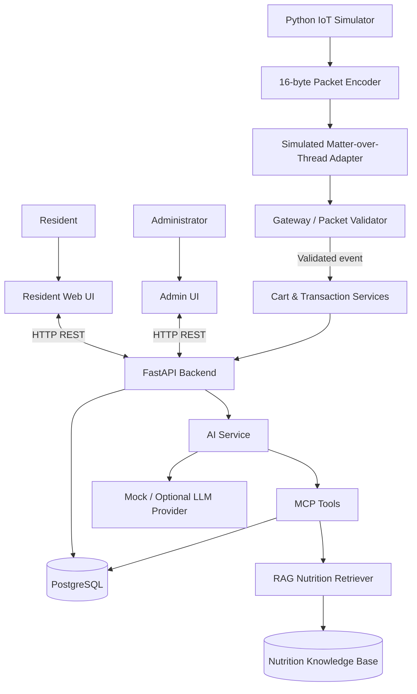

# System Architecture

## 1. Architecture principle

Retain the proposal's original four-layer structure. The project is a software prototype: implement the application and packet flow, and simulate the physical Matter-over-Thread transport rather than claiming to deploy a real Thread mesh network.

## 2. Four layers

### Layer 1 — Perception & Interaction
Components:
- Resident Web UI (LINE LIFF can be treated as a future UI channel; the demo may use responsive web UI).
- Administrator Web UI.
- Resident card ID input (simulates RFID/NFC).
- Python IoT Simulator (simulates ESP32 + HX711 sensor readings).
- Optional product image classification result (may be a seeded/mock classification result).

Responsibilities:
- Collect user actions.
- Simulate sensor weight and product events.
- Display cart, checkout, and nutrition advice.

### Layer 2 — Network Communication
Proposal architecture:
- Matter over Thread.
- Matter Manufacturer Specific Cluster as the conceptual carrier for the custom application payload.
- Custom 16-byte binary packet.

Demo implementation:
- Python Simulator creates the 16-byte packet.
- A local `MatterTransportAdapter` interface simulates sending the packet to the Gateway.
- The adapter should be clearly labelled as a software simulation of the Matter-over-Thread device-to-gateway path.
- Keep transport logic isolated so a real Matter SDK / Thread Border Router could be integrated later.
- HTTP REST is the implemented communication protocol between frontend and FastAPI backend.

Important distinction:
- Thread is the low-power mesh network layer.
- Matter is the application-layer interoperability standard.
- HTTP REST is used for frontend/backend application requests.
- The 16-byte frame is the project's custom application payload, not a replacement for Matter or HTTP.

### Layer 3 — Gateway & Security
Components:
- Gateway service/module.
- Packet parser.
- Header and command validation.
- Sequence Number replay check.
- XOR + educational hash check.
- Event mapper that converts a valid packet into a normalized application event.
- Optional cross-check of product ID and plausible weight range.

Responsibilities:
- Reject malformed or invalid packets.
- Reject duplicate/old sequence numbers.
- Only forward valid events to the backend cart service.
- Keep the packet protocol independent from cart/order business logic.

### Layer 4 — Smart Service
Components:
- MCP tool server / tool adapter.
- RAG retriever over a small nutrition knowledge base.
- LLM Agent service.
- Resident health preference context.
- Product and inventory query tools.

Responsibilities:
- Retrieve product, stock and nutrition facts.
- Compose personalized suggestions.
- Keep AI read-only for authoritative business data in this prototype.
- Use mock AI provider by default; optional real provider can be configured via environment variable.

### Data layer
PostgreSQL stores:
- Residents and card IDs.
- Health preferences.
- Products and inventory.
- Cart and cart items.
- Orders and order items.
- IoT event audit records.
- Device sequence state.

Optional pgvector can be added later; it is not mandatory for the first working demo.

## 3. High-level component diagram



## 4. Main event flow

1. Resident logs in using a seeded card ID through HTTP REST.
2. Resident chooses an item and weight in the UI or simulator.
3. Simulator constructs an event and encodes it into exactly 16 bytes.
4. Simulated Matter-over-Thread adapter passes the byte frame to the Gateway.
5. Gateway validates packet structure, checksum and sequence number.
6. Gateway maps the packet into a normalized event.
7. Backend cart service validates product existence and weight range.
8. Backend updates cart and calculates price using database product price.
9. Frontend refreshes cart using HTTP REST.
10. Checkout creates a simulated payment result and order.
11. AI service reads resident preferences and order/product facts to create a nutrition suggestion.

## 5. Responsibility boundaries
- Simulator: generate sensor-like events; no business pricing.
- Packet encoder/parser: binary serialization only.
- Gateway: validate packet and replay sequence.
- Backend: authoritative cart, price, inventory, order and payment state.
- AI service: retrieve and explain nutrition information; no authoritative writes to transactions.
- Frontend: presentation and user input; no trusted price calculation.

## 6. Suggested repository structure

```text
community-smart-grocery/
├── CLAUDE.md
├── README.md
├── .env.example
├── docker-compose.yml
├── docs/
│   ├── SRS.md
│   ├── ARCHITECTURE.md
│   ├── API_SPEC.md
│   ├── DATABASE.md
│   ├── IOT_PROTOCOL.md
│   └── DEVELOPMENT_ROADMAP.md
├── frontend/
├── backend/
│   ├── app/
│   │   ├── api/
│   │   ├── core/
│   │   ├── models/
│   │   ├── schemas/
│   │   ├── services/
│   │   ├── gateway/
│   │   └── ai/
│   └── tests/
├── simulator/
└── knowledge_base/
```

## 7. Technology choices
- React + TypeScript + Vite.
- FastAPI + Pydantic.
- PostgreSQL.
- SQLAlchemy.
- Python simulator and gateway modules.
- Docker Compose.
- Mock AI provider first; optional LLM integration later.
- MCP integration isolated behind an adapter.
