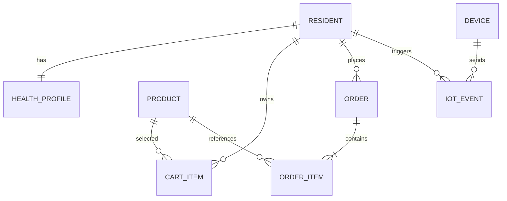

# Database Design

Use PostgreSQL as the default database. Keep the schema small and understandable.

## 1. Entity overview

## 2. Tables

### residents
- `id`: primary key.
- `card_id`: unique demo card identifier.
- `display_name`.
- `created_at`.

### health_profiles
- `id`: primary key.
- `resident_id`: FK to residents, unique.
- `dietary_preferences`: JSON/JSONB, e.g. `["low_sodium"]`.
- `allergies`: JSON/JSONB.
- `notes`: optional text; avoid storing unnecessary sensitive health details in the demo.

### products
- `id`: primary key.
- `product_code`: unique integer used by the IoT packet.
- `name`.
- `category`.
- `price_per_kg`: decimal.
- `stock_grams`: integer.
- `min_weight_grams`, `max_weight_grams`: plausible per-event bounds.
- `nutrition_json`: JSON/JSONB for demo nutrition facts.
- `is_active`.

### carts
- `id`: primary key.
- `resident_id`: FK, unique active cart per resident.
- `updated_at`.

### cart_items
- `id`: primary key.
- `cart_id`: FK.
- `product_id`: FK.
- `weight_grams`: integer, positive.
- Unique `(cart_id, product_id)` for a simplified one-line-per-product cart.

### orders
- `id`: primary key.
- `resident_id`: FK.
- `total_amount`: decimal.
- `payment_status`: `PAID` or `FAILED`.
- `created_at`.

### order_items
- `id`: primary key.
- `order_id`: FK.
- `product_id`: FK.
- `product_name_snapshot`.
- `price_per_kg_snapshot`.
- `weight_grams`.
- `subtotal`.

### devices
- `id`: primary key.
- `device_code`: unique.
- `description`.
- `last_sequence_number`: integer, initial value -1.

### iot_events
- `id`: primary key.
- `resident_id`: nullable FK.
- `device_id`: FK.
- `command`.
- `product_code`.
- `weight_grams`.
- `packet_hex`.
- `validation_status`.
- `rejection_reason`: nullable.
- `created_at`.

## 3. Data rules
- Store weight as integer grams to avoid floating-point errors.
- Store prices as Decimal / NUMERIC, not float.
- Compute subtotal on backend:
  `subtotal = price_per_kg * weight_grams / 1000`
- Round monetary values consistently to 2 decimal places.
- Inventory is decremented only after simulated payment succeeds.
- For failed payment, preserve cart and do not decrement inventory.
- Sequence state is maintained per device.
- Use transactions for checkout and inventory update.

## 4. Seed data
Create at least:
- 2 residents with demo card IDs, e.g. `CARD-1001`, `CARD-1002`.
- 5–8 produce products with distinct product codes.
- Example health preferences: `low_sodium`, `vegetarian`.
- Small, clearly fictional inventory values.
- A small nutrition knowledge seed file.
