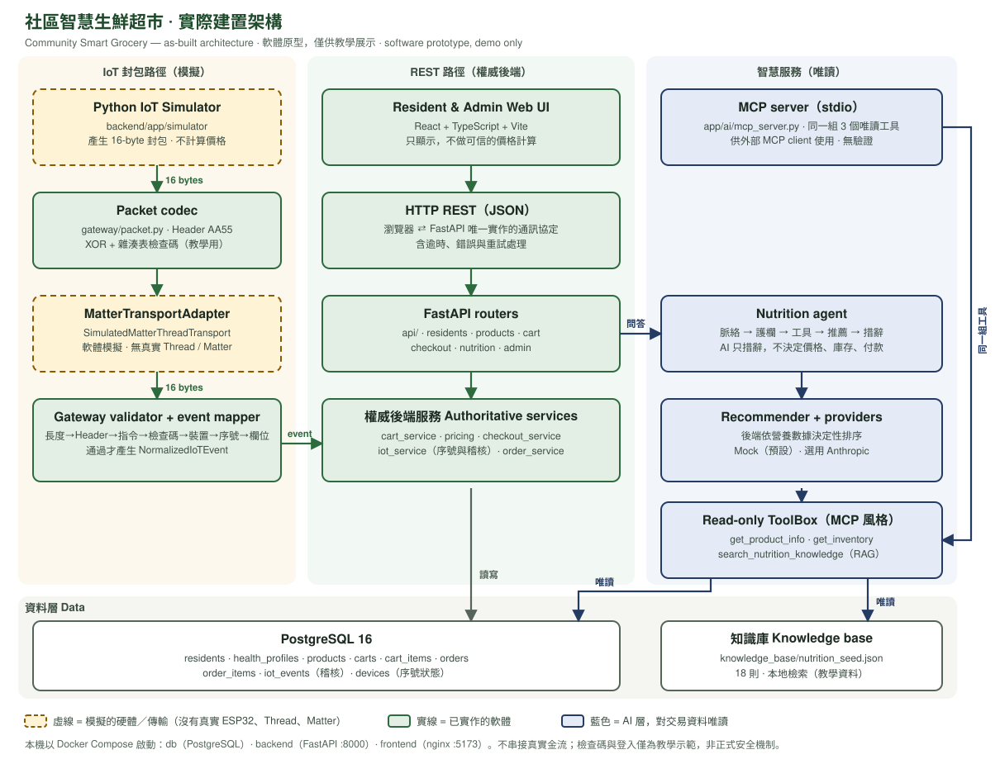
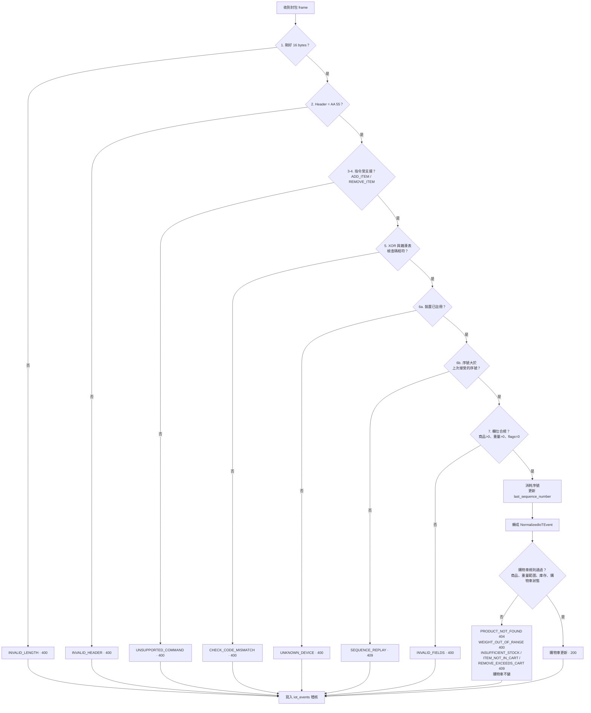
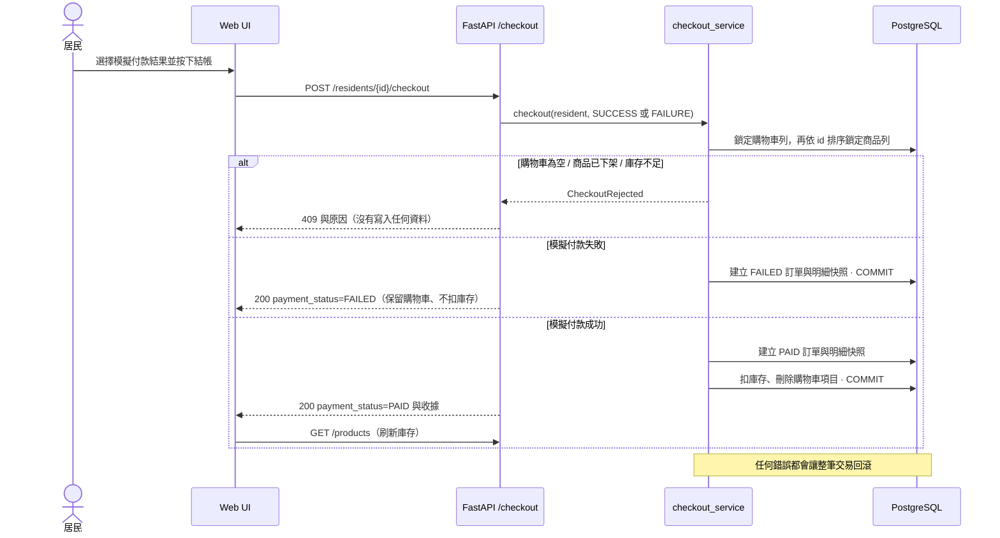
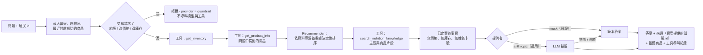
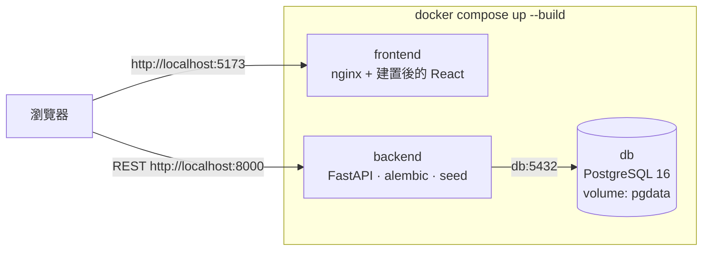

# 圖表集

> 這些圖依**實際建置結果**繪製（模組名稱對應程式碼）。`docs/ARCHITECTURE.md` 是規格層級的設計圖；
> 兩者若有出入，以本文件與程式碼為準。Mermaid 圖可直接在 GitHub / GitLab / VS Code 預覽中顯示。

## 1. 實際建置架構



虛線 = 模擬的硬體／傳輸；實線 = 已實作的軟體；藍色 = AI 層（對交易資料唯讀）。

## 2. 16-byte 封包格式

欄位皆為大端序（big-endian）。實作在 `backend/app/gateway/packet.py`。

| 位元組 | 欄位 | 大小 | 說明 |
|---|---|---|---|
| 0–1 | Header | 2 | 固定 `AA 55` |
| 2–3 | Device ID | 2 | 對應 `devices.id` |
| 4–5 | Sequence | 2 | 防重放序號（uint16） |
| 6 | Command | 1 | `01` BIND_CARD · `02` ADD_ITEM · `03` REMOVE_ITEM · `04` CHECKOUT · `05` ALERT |
| 7–8 | Product code | 2 | 商品代碼 |
| 9–11 | Weight | 3 | 公克（uint24） |
| 12 | Flags | 1 | 目前必須為 0 |
| 13 | XOR | 1 | 位元組 0–12 的 XOR |
| 14–15 | Signature | 2 | 位元組 0–12 加示範金鑰的雜湊表簽章（**教學用，非密碼學安全**） |

範例（裝置 1、序號 1、ADD_ITEM、商品 101、320 公克）：

```
AA55 0001 0001 02 0065 000140 00 D9 847C
```

## 3. Gateway 驗證與購物車更新流程

每一種結果（含被拒絕的封包）都會寫入 `iot_events` 稽核表。圖中的狀態碼是 REST 回應的 HTTP 狀態；
被拒絕時回應本文仍包含每一步的驗證結果。



重點：Gateway 只要有任何一步失敗，序號就**不會**被消耗；通過全部 Gateway 檢查後即消耗序號，
即使購物車之後因業務規則拒絕。

## 4. 模擬結帳（單一資料庫交易）



## 5. 營養助理流程



## 6. Docker Compose 拓樸



三個 port 都只綁定 `127.0.0.1`（示範用密碼、無管理員驗證，請勿對網路開放）。
瀏覽器直接呼叫後端，所以 `VITE_API_BASE_URL` 必須是**瀏覽器**連得到的網址。
